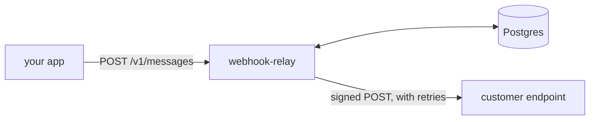

# webhook-relay

[](https://github.com/Urthella/webhook-relay/actions/workflows/ci.yml)

Sends webhooks reliably, so your application doesn't have to. You hand it a message over HTTP, and it
stores the message in Postgres, signs it, delivers it, retries failures with backoff and keeps what never
got through in a dead-letter state you can send again. Signatures follow
[Standard Webhooks](https://www.standardwebhooks.com).



## Run it

You need Go and a Postgres database. It creates its tables at startup.

```bash
git clone https://github.com/Urthella/webhook-relay && cd webhook-relay
export DATABASE_URL=postgres://localhost/webhooks
export API_TOKEN=$(openssl rand -hex 32)
go run .
```

Register an endpoint, which returns its signing secret, then send a message to it:

```bash
curl -H "Authorization: Bearer $API_TOKEN" localhost:8080/v1/endpoints \
  -d '{"url": "https://example.com/hooks"}'

curl -H "Authorization: Bearer $API_TOKEN" localhost:8080/v1/messages \
  -d '{"endpoint_id": "ep_...", "type": "order.paid", "data": {"order": 42}, "idempotency_key": "order-42-paid"}'
```

| Request | What it does |
| --- | --- |
| `POST /v1/endpoints` | Registers a URL and returns its secret |
| `POST /v1/endpoints/{id}/enable` | Turns an endpoint back on after a `410` disabled it |
| `POST /v1/messages` | Queues a message. Sending the same `idempotency_key` again returns the first one |
| `GET /v1/messages/{id}` | Shows a message's status and every attempt |
| `POST /v1/messages/{id}/redrive` | Sends a dead message again, with its attempts reset |

`go run . -help` lists the options.

## What the receiver gets

```
POST /hooks
webhook-id: msg_6795d9e8f90ca1ed5a997177
webhook-timestamp: 1793650000
webhook-signature: v1,FwF...

{"type":"order.paid","timestamp":"2026-11-02T20:22:07Z","data":{"order":42}}
```

The signature is an HMAC-SHA256 over `id.timestamp.body`, so any Standard Webhooks library can verify it,
including the `verify` package in this repo for Go receivers:

```go
body, err := io.ReadAll(http.MaxBytesReader(w, r.Body, 1<<20))
if err != nil {
	http.Error(w, "body too large", http.StatusRequestEntityTooLarge)
	return
}
if err := verify.Request(secret, r.Header, body); err != nil {
	http.Error(w, "bad signature", http.StatusUnauthorized)
	return
}
```

It compares in constant time, refuses timestamps more than 5 minutes off to limit replays, and accepts any of
several signatures so senders can rotate secrets.

The ID stays the same across retries, which is what a receiver deduplicates on. The timestamp is the
attempt's, so each retry has a new signature.

## How delivery behaves

- **A `2xx` means delivered.** Anything else is a failure, including a redirect.
- **Retries double each time**, from 5 seconds up to an hour, with jitter. After 8 attempts the message goes
  dead.
- **`429` and `503` with `Retry-After`** wait as long as asked, up to the same limit.
- **`410 Gone` disables the endpoint.** The receiver is saying it doesn't want these any more, so the relay
  stops, and its other messages wait until you enable it again.

## Blocking requests to internal addresses

Whoever can register an endpoint can make this server send requests, so a careless relay lets them reach
your internal network or a cloud metadata service. So:

- Endpoints must use `https`.
- Private, loopback, link-local, carrier-grade NAT and reserved addresses are refused, in both IPv4 and IPv6,
  including IPv4 written as IPv6.
- The check runs when the connection opens, after DNS. A hostname that passes at registration and later
  resolves to `169.254.169.254` still gets blocked, which stops DNS rebinding.
- Redirects aren't followed, because they could point anywhere.
- Proxy settings in the environment are ignored, so they can't route around this.

`-allow-private-addresses` turns all of this off for local development.

## What survives a crash

Delivery is at-least-once. A worker holds a message on a lease, so if it dies, another one picks the message
up when the lease ends. If a worker dies after the receiver got the message but before recording that, the
message goes out again with the same `webhook-id`. Receivers have to deduplicate on that ID.

On shutdown, it stops taking new work and lets deliveries in progress finish, which can take up to the
delivery timeout.

## Limits

- **No ordering.** Messages to one endpoint can arrive in any order, especially around retries.
- **One slow endpoint can hold up others.** There's no per-endpoint limit, so an endpoint that always times
  out uses up delivery slots until its messages go dead.
- **One API token.** There are no tenants or per-customer access.
- **Secrets are stored unencrypted in Postgres,** because they're needed to sign. Protect the database.
- **Nothing cleans up old rows.** Delete delivered messages and their attempts on a schedule.
- **Not run under production load.** There's no benchmark yet.

## Tests

```bash
nix develop
TEST_DATABASE_URL=postgres://localhost/webhooks_test go test -race ./...
```

The tests use a real Postgres. They cover retries, dead letters, redrives, `410`, crashed workers, four
workers sharing 300 messages with none sent twice, a stale worker that can't overwrite a newer attempt, and a
shutdown during a delivery. The signature test uses the example from the Standard Webhooks libraries' own
tests.

To check that the tests can fail, 25 bugs were planted one at a time, and all 25 got caught, including a
dialer that doesn't check addresses, ignored leases and a signature missing the message ID. One real bug
turned up while running the program itself: on shutdown, the database pool closed before deliveries in
progress could record their results. There's now a test for that.

Claude, Anthropic's AI model, wrote this with Halil Utku Demirtaş directing the work.

## License

MIT
